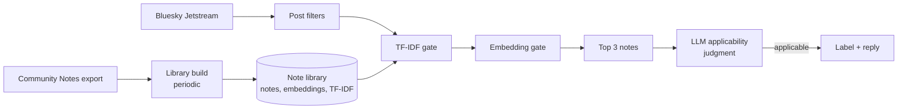

# CrossNote

CrossNote is a Bluesky labeler that brings X's Community Notes to Bluesky. When a Bluesky post makes a claim that a recent Community Note (rated Helpful on X) already corrects, CrossNote applies a `misinformation` label to the post and replies with the full note and a link to the X post it was written for.

This repository contains the deployed system described in our paper, which is coming soon on arXiv.

On Bluesky: [@crossnote.bsky.social](https://bsky.app/profile/crossnote.bsky.social)

- [How it works](#how-it-works)
- [Use the labeler](#use-the-labeler)
- [Differences from the paper](#differences-from-the-paper)
- [Run it yourself](#run-it-yourself)
- [Data and ethics](#data-and-ethics)
- [Collaborate](#collaborate)
- [Cite](#cite)

## How it works



**Note library** (`library/build.py`, rebuilt periodically; each rebuild fetches the new notes' X posts through the paid X API). Starting from X's public Community Notes export, a note enters the library if it is rated Helpful now and was first rated Helpful in the 7 days before the export. For each note, the original X post is fetched through the X API and kept only if it is in English. Two LLM filters (`prompts/author_dependence.txt`, `prompts/media_dependence.txt`) drop notes that only make sense for a particular author or a particular image or video. Each remaining note is indexed as "X post text + note text" with text-embedding-3-large and a unigram TF-IDF vectorizer.

**Live matching** (`src/stream.ts`, `pipeline/crossnote_match.py`). Each new Bluesky post goes through:

| Step | What happens | Setting |
|---|---|---|
| Post filters | original posts and quote posts only (no replies), English or no language tag, more than 2 words | |
| Stage 1, lexical | highest TF-IDF cosine to any note in the library | ≥ 0.1376 |
| Stage 1, embedding | highest text-embedding-3-large cosine to any note | ≥ 0.5003 |
| Stage 2 | the 3 notes with the highest embedding cosine | top 3 |
| Stage 3 | an LLM judges whether each note applies to the post (`prompts/applicability.txt`); the highest-ranked applicable note is the match | `gpt-6.1-sol` |

On a match, CrossNote signs a `misinformation` label for the post and replies with "Community Note from X, rated Helpful:", the note and a link to the X post, split into a thread when it's longer than 300 characters.

In the paper's evaluation, the Stage 1 thresholds keep 100% (lexical) and 99% (embedding) of known positives, Stage 2 has a Recall@3 of 100% with 5,000 distractor notes, and the Stage 3 model has 96.0% precision and 64.7% recall.

**Two modes.** `CROSSNOTE_MODE=followers` (the default) only watches posts by accounts that follow the labeler. `CROSSNOTE_MODE=full` watches every post on Bluesky and caps replies at `MAX_REPLIES_PER_HOUR` (default 20); matches over the cap are labelled but not replied to.

## Use the labeler

- **To see labels:** open [@crossnote.bsky.social](https://bsky.app/profile/crossnote.bsky.social) and subscribe to the labeler.
- **To have your posts checked:** follow the account. In the default mode, only followers' posts are checked.
- **If a label on your post is wrong:** [open a "Wrong label" issue](../../issues/new?template=wrong_label.yml) or email the contact below. We review every report and remove labels that don't apply.
- **To see why a post was labeled:** paste its link into the [demo page](https://nishkaarora.github.io/CrossNote/). It shows the matched note, each stage's scores and the model's reasons, how long the correction took on Bluesky compared with X, and asks whether the match is right.

## Differences from the paper

| | Paper | This deployment |
|---|---|---|
| LLM for Stage 3 and the library filters | `gpt-5.6-sol` (Stage 3), `gpt-5.6` (filters) | `gpt-6.1-sol` for both |
| Model versions | bare OpenAI aliases at the dates in `configs/models.yaml` | bare aliases, not pinned; the underlying model can change |
| Note library | fixed evaluation set | 7-day window of notes before each build's export date; rebuilt periodically |

Thresholds, prompts and the Stage 2 cutoff are the ones the paper evaluated (`configs/thresholds.yaml`, `prompts/`). Deployment-only settings are in `configs/pipeline.yaml`. Because the LLM differs, live precision and recall may differ from the paper's numbers.

## Run it yourself

You need Node 20, Python 3.11, an OpenAI API key, and an X API bearer token to build a note library. See [CONTRIBUTING.md](CONTRIBUTING.md) for running locally in dry-run mode.

**Build a note library**

```bash
python -m venv .venv && .venv/bin/pip install -r library/requirements.txt
python data/download_notes.py                                  # → data/raw/<export-date>/
.venv/bin/python -m library.build --cn-dir data/raw/<export-date>
```

This writes `data/library/<export-date>/`. X post text is cached locally and must not be redistributed.

**Deploy to Fly.io**

```bash
fly launch --no-deploy            # or use the fly.toml here with your own app name
fly volumes create crossnote_data
fly secrets set LABELER_DID=... LABELER_SIGNING_KEY=... BSKY_HANDLE=... BSKY_PASSWORD=... OPENAI_API_KEY=...
fly deploy
library/upload.sh <export-date>   # copies the snapshot to the volume and makes it live
```

The matcher checks `/data/library/CURRENT` every 5 minutes and swaps in a new snapshot without a restart. To switch modes: `fly secrets set CROSSNOTE_MODE=full`, and `fly secrets unset CROSSNOTE_MODE` to go back.

**Environment variables**

| Variable | Default | Purpose |
|---|---|---|
| `LABELER_DID` | required | DID of the labeler account |
| `LABELER_SIGNING_KEY` | required | hex secp256k1 key that signs labels |
| `BSKY_HANDLE`, `BSKY_PASSWORD` | required | account and app password that post replies |
| `OPENAI_API_KEY` | required | embeddings and Stage 3 |
| `CROSSNOTE_MODE` | `followers` | `followers` or `full` |
| `CROSSNOTE_DRY_RUN` | on | set to `0` to label and reply; anything else only logs matches |
| `MAX_REPLIES_PER_HOUR` | `20` | full mode reply cap |
| `EXCLUDED_DIDS` | empty | comma-separated DIDs whose posts are never processed |
| `DISABLE_AUTO_LABEL` | off | `1` serves the label stream without watching Bluesky |
| `ADMIN_TOKEN` | unset | enables `POST /admin/label` for manual labels |
| `DEMO_ORIGINS` | empty | comma-separated origins allowed to send demo-page feedback |
| `DATA_DIR` | `/data` | where logs are written |
| `LIBRARY_ROOT` | `/data/library` | where library snapshots live |
| `X_BEARER_TOKEN` | | library build only |

**Repository layout**

```
src/           Node labeler: label stream, Jetstream, replies, admin and demo endpoints
pipeline/      Python matcher served on a unix socket
library/       note library build and upload
configs/       thresholds and model settings (paper and deployment)
prompts/       LLM prompts for the library filters and Stage 3
data/          Community Notes download script
scripts/       one-off tools (publish label definitions, list recent labels)
demo/          static demo page, deployed to GitHub Pages by .github/workflows/pages.yml
```

**Demo page.** `demo/` is a static page on GitHub Pages that reads `GET /demo/match` and `GET /demo/summary` from the labeler and sends answers to `POST /demo/feedback` (`src/demo-api.ts`). To preview it, run `python3 -m http.server 8000` in `demo/` and open `http://localhost:8000/?example=1`, or add `?api=http://localhost:8080` to point it at a local labeler. To enable it on a fork: set Pages' source to "GitHub Actions", set `API_BASE` in `demo/index.html` to your Fly app, and set `DEMO_ORIGINS` in `fly.toml` to your Pages origin.

## Data and ethics

**What the bot stores** (on the Fly volume, not in this repo):

- For each match: the post's `at://` URI (which contains the author's DID), the note ID, similarity scores, the LLM's short reason, and whether a label and reply were posted. No post text.
- For posts that reach Stage 3 but don't match: scores and note IDs only, with no URI or text.
- Counts of posts processed per minute.
- Answers sent from the demo page: the post's URI, the note ID, yes/no/not sure and an optional comment. No IP address or account.

**The demo page** shows one post at a time, looked up by its link, and only while the post is labeled: there is no list of labeled posts or accounts. A post's page stops working if its label is removed, the post is deleted, its author is excluded, or its author has asked Bluesky not to show their posts to logged-out viewers.

**What leaves the system:** text of a post that passes the TF-IDF gate (computed locally) is sent to the OpenAI API for embedding, and to Stage 3 if it also passes the embedding gate. Labels and replies are public on Bluesky.

**What's not in this repo:** no Bluesky posts, X posts or note library snapshots. Community Notes data comes from X's public download and is subject to X's terms. X post text is retrieved through the X API and is subject to the X Developer Agreement and Policy; anyone rebuilding the library needs their own token.

**Opting out:** in the default mode, only followers' posts are checked, so unfollowing stops it. To have your account excluded in every mode, or a label removed, open an issue or email the contact below; excluded accounts are listed in the `EXCLUDED_DIDS` secret and their posts are skipped before any processing.

## Collaborate

We're looking for collaborators on:

- **Research:** Community Notes, misinformation and cross-platform fact-checking, and measuring how labels and replies are received.
- **Engineering:** ATProto and Bluesky tooling, scaling past Jetstream's 10,000-account filter, cheaper matching.
- **Coverage:** non-English posts, and claims made in images or video.
- **Evaluation:** annotating live matches to measure precision in deployment.

The [roadmap](ROADMAP.md) lists open problems. To talk about a collaboration, email **nishkaa@stanford.edu**. Code contributions are welcome through pull requests; see [CONTRIBUTING.md](CONTRIBUTING.md).

## Cite

The paper is coming soon on arXiv, and we'll add its citation here. Until then, please cite this repository (see [CITATION.cff](CITATION.cff), or "Cite this repository" on GitHub):

```bibtex
@software{crossnote,
  author = {Arora, Nishka},
  title  = {CrossNote},
  year   = {2026},
  url    = {https://github.com/NishkaArora/CrossNote}
}
```

## License

Code is under the [MIT License](LICENSE). Community Notes data and X content are not included and keep their own terms.
